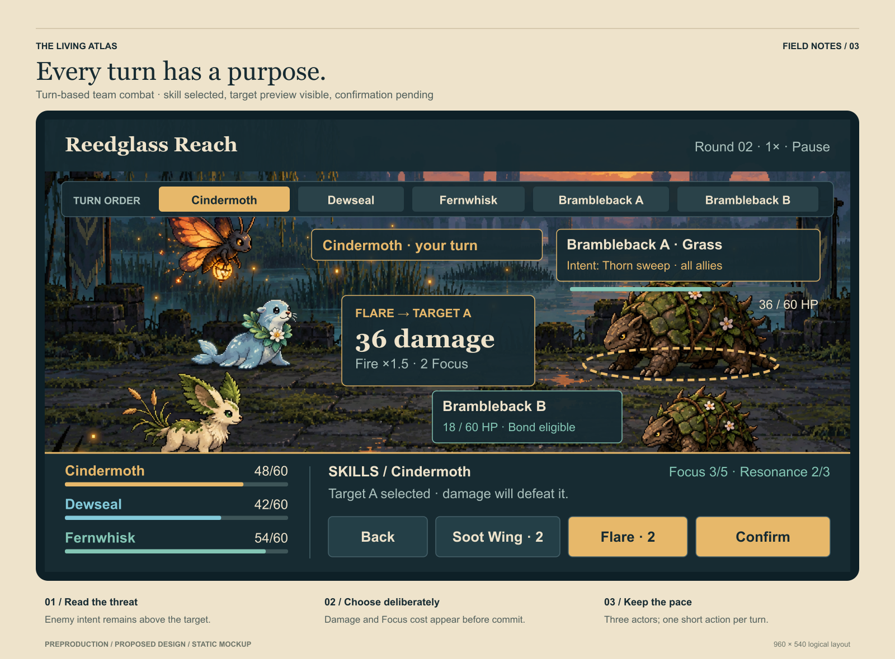

# MagiSprite

A mobile creature-collecting roguelite in **preproduction**: form bonds with Sprites, fight in turn-based parties, and develop a persistent Sprite Mage and Sprite Book.

Repository: [GetFluxxed/MagiSprite](https://github.com/GetFluxxed/MagiSprite).

## Selected combat direction



The owner selected **only this combat view** as the visual concept for the game. Battles must depict their surrounding area. The in-scene Sprite designs are endorsed, with required idle body animations, idle emissive effects, and randomly cycling emotes during combat.

The other six views are preserved as unapproved historical studies. Their rejection does not remove the Sprite Book, Mage progression, or other gameplay requirements. New visual directions for those screens remain open.

## Start here

| Document | Purpose |
|---|---|
| [ARCHITECTURE.md](ARCHITECTURE.md) | 43 source requirements, approval status, and undecided choices |
| [ART_DIRECTION.md](ART_DIRECTION.md) | Accepted combat reference and proposed scene/animation production specification |
| [DESIGN.md](DESIGN.md) | Proposed combat, runs, bonding, progression, loot cascade math, economy, story, and tests |
| [ENGINEERING.md](ENGINEERING.md) | Existing owner policy copied unchanged; its supplied status remains Draft 0.1 |
| [Visual gallery](wireframes/index.html) | Approved combat concept first; other views labeled as unapproved history |
| [Wireframe guide](wireframes/README.md) | File index, scenario values, approval labels, and editing notes |
| [Source provenance](reference/PROVENANCE.md) | Original brief, later feedback, policy hash, and retrieval limits |
| [Verification](reference/VERIFICATION.md) | Checks performed and untested work |

*The Living Atlas*, which appears in earlier artwork, is a proposed creative theme/title. Numerical balance, party size, capture rules, tree details, animation timings, and technical choices remain proposals unless recorded as owner requirements.

## Get and view the project

Prerequisites: Git to clone; a text editor and browser or image viewer to inspect the files.

```sh
git clone https://github.com/GetFluxxed/MagiSprite.git
cd MagiSprite
```

Open `wireframes/index.html` locally in a browser, or open PNGs directly. The gallery is static HTML/CSS and works offline. GitHub displays the README and PNGs directly; it does not run the gallery as a hosted website. No engine, game executable, install/build step, account, or deployment is part of this repository yet.

## Maintain the preproduction files

Record owner decisions in ARCHITECTURE.md and keep proposals in DESIGN.md or ART_DIRECTION.md. Update the gallery's approval labels when a visual decision changes. Edit SVG layouts in a vector editor and refresh their PNG previews at 1600 × 1180. Keep generated originals and prompts; concept art is not a production animation sheet.

The engineering policy is an unchanged copy of an existing owner download. Its portfolio-discussion origin is corroborated; remote attachment bytes were unavailable for direct comparison. Its checksum and limits are recorded in provenance. Do not rewrite it to introduce game-specific assumptions.

To verify a clean checkout's manifest on macOS:

```sh
shasum -a 256 -c MANIFEST.sha256
```

On GNU systems use `sha256sum -c MANIFEST.sha256`. After edits, refresh the manifest over repository content, excluding `.git`, ignored files, and the manifest itself; then check links and visually inspect changed screens. Commit documents, previews, and the manifest together. The manifest verifies file integrity, not gameplay or animation quality.

## Next design work

1. Produce and review animation studies based on the combat Sprites, starting with Cindermoth.
2. Explore additional area-specific combat scenes using the selected direction.
3. Redesign noncombat screens; none has an accepted visual direction yet.
4. Resolve open gameplay decisions and run the paper tests before separately authorizing gameplay implementation.

There are currently **no finished animation clips or gameplay code**. This repository contains preproduction documents, static art, editable layouts, and source references.
